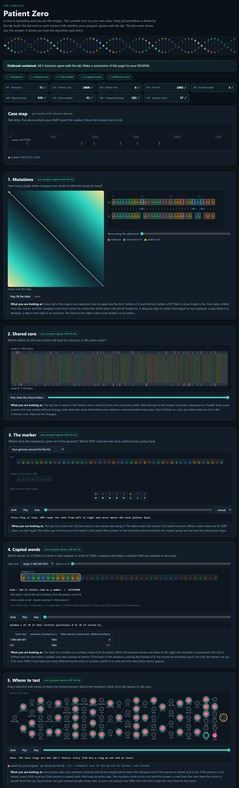

# Assignment 4. Patient Zero

Student ID: 250653
Name: Zharkyn Akhmetov
Group: SE-2510

How to start: `START_HERE.md`. The task: `docs/Assignment4.pdf`.

## Program output

The 9 lines your program prints on your data (`java -cp out Main`):

    Mutations: 71
    Shared core: 1060
    Marker hits: 6
    First hit: 1902
    Border length: 3
    Shared words: 545
    Tests needed: 41
    Cheapest testing: 182
    Longest chain: 37

My outbreak report (a screenshot of `output/outbreak.html`):

The image combines six captures of the generated page in reading order.

## Questions

Mission 1. What does the cell d[i][j] of your table mean, and how is it computed from other cells?

`d[i][j]` is the minimum cost to turn the first `i` letters of A into the first `j` letters of B. Take the cheapest of deletion (above + 1), insertion (left + 1), or matching/replacing the final letter (diagonal + 0 or 1).

Mission 2. How is the longest common subsequence different from the longest common substring? My Shared core is bigger than the number of letters that are the same at the same place: why?

A substring must be contiguous. An LCS can skip letters in either strain, so an insertion can shift a matching block and it can still contribute to the LCS.

Mission 3. What does the prefix function tell you, and why does the pointer in the text never go back in KMP? What is the Border length of my marker and what does it mean?

`pi[i]` gives the length of the longest proper prefix of the pattern through index `i` that is also its suffix. On a mismatch KMP shortens the already matched prefix using this table while keeping its current genome position. In `GTCTTGTC`, the border is `GTC`, of length 3.

Mission 4. Why must you compare the letters after the hashes are equal? What happens to the cost of Rabin-Karp if many windows have the same hash?

Different windows may have the same hash, so I compare their letters before counting a match. A large collision bucket can force a window in A to be compared against many windows in B, with up to `k` comparisons per candidate.

Mission 5. What are the two states of a person in your DP, and how do you get the answer for a person from its children? Why does a greedy "test the person with most links first" not always give the cheapest answer?

If a person is tested, each child can take its cheaper state. If the person is skipped, every child must be tested. On a star with three leaves costing 1 each and a center costing 10, picking the most connected person costs 10 while testing all leaves costs 3.

## AI use

ChatGPT was used as a development assistant for algorithm implementation, debugging, testing, and README preparation. It generated substantial portions of the implementation and documentation under review during the development process.

## Timing (Mission 7)

Milliseconds, average of 3 runs, from `java -cp out Bench`.

| test | size | time |
|---|---|---|
| naive search | 20 000 / 40 000 / 80 000 | 28.5 / 65.5 / 138.9 |
| KMP | 20 000 / 40 000 / 80 000 | 2.5 / 0.9 / 0.4 |
| edit distance | 500 / 1000 / 2000 / 4000 | 9.7 / 7.3 / 18.2 / 68.3 |

Naive search grew by about 2.3× and 2.1× as the text doubled with a fixed pattern length. The sub-millisecond KMP measurements after the first size are noisy and include JVM warm-up effects, so the ratios do not estimate its linear growth reliably. Edit distance rose by about 3.8× from 2,000 to 4,000, close to the 4× increase in table cells.

## Complexity

Here a and b are the strain lengths, n and m are the text and pattern lengths, k is the window length, and v is the number of people.

| algorithm | time | space | assumptions |
|---|---|---|---|
| Edit distance | O(ab) | O(ab) | a and b are strain lengths |
| LCS | O(ab) | O(ab) | Full DP table |
| Prefix function and KMP | O(n + m) | O(n + m) | Prefix table and hit buffer |
| Rabin-Karp (shared words) | O(a + b + ck) expected for hash-map access | O(b) | c candidate pairs checked, up to (a−k+1)(b−k+1) for valid k |
| Tree DP and diameter | O(v) | O(v) | Tree has v−1 links. Includes recursion and reconstruction. |